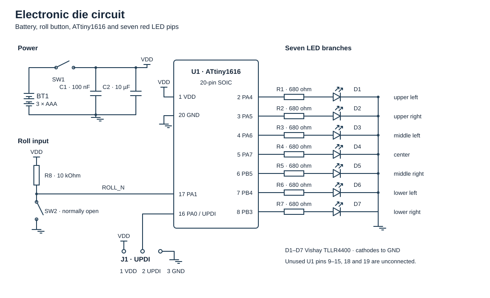

# Electronic dice circuit

## Power and connections

BT1 holds three replaceable alkaline AAA cells in series. Each cell is nominally 1.5 V, giving a 4.5 V pack. SW1 disconnects the battery positive lead from VDD. The design feeds the ATtiny1616 directly and uses its internal oscillator with a CPU clock at or below 5 MHz. Connect C1 close to U1 pins 1 and 20. Use a 100 nF ceramic capacitor for C1 and a 10 µF ceramic capacitor for C2, both rated at least 10 V. [Energizer E92 datasheet](https://data.energizer.com/pdfs/E92_Max_NA-NOV.pdf) · [Microchip operating ratings](https://onlinedocs.microchip.com/oxy/GUID-9175774B-9B45-45D7-A62D-28F07E411073-en-US-4/GUID-CCDC69CD-7A24-4DC6-91CE-5690BADCEBCE.html)

| Net or path | Connections |
| --- | --- |
| Battery positive | BT1+ to SW1 terminal 1 |
| VDD | SW1 terminal 2, U1 pin 1, C1.1, C2.1, R8.1, J1 pin 1 |
| GND | BT1−, U1 pin 20, C1.2, C2.2, SW2.2, D1–D7 cathodes, J1 pin 3 |
| ROLL_N | U1 pin 17 (PA1), R8.2, SW2.1. R8 is 10 kΩ and SW2 is normally open. |
| UPDI | U1 pin 16 (PA0) to J1 pin 2. Use target-voltage sensing with the battery providing power. |
| Unconnected | U1 pins 9–15, 18 and 19 |

Each GPIO sources an individual LED through a 680 Ω series resistor. The diode anode goes to the resistor and the cathode goes to GND. Use the 20-pin SOIC package for U1 and Vishay TLLR4400 red LEDs for D1–D7. [Microchip SOIC pinout](https://onlinedocs.microchip.com/oxy/GUID-9175774B-9B45-45D7-A62D-28F07E411073-en-US-4/GUID-7F192715-D8BB-41A7-A993-95595D465CE0.html) · [Vishay LED datasheet](https://www.vishay.com/doc/?83029=)

| U1 output | Branch | Pip |
| --- | --- | --- |
| 2 PA4 | R1, D1 | upper left |
| 3 PA5 | R2, D2 | upper right |
| 4 PA6 | R3, D3 | middle left |
| 5 PA7 | R4, D4 | center |
| 6 PB5 | R5, D5 | middle right |
| 7 PB4 | R6, D6 | lower left |
| 8 PB3 | R7, D7 | lower right |

| Face | LEDs on |
| --- | --- |
| Blank | None |
| 1 | D4 |
| 2 | D1, D7 |
| 3 | D1, D4, D7 |
| 4 | D1, D2, D6, D7 |
| 5 | D1, D2, D4, D6, D7 |
| 6 | D1, D2, D3, D5, D6, D7 |

## Simulation model

The [SysML circuit](../model/60_systems/00_ElectronicDice/Circuit.sysml) connects the two supply rails, the decoupling, the switch, the MCU I/O and each LED branch. The [Modelica component equations](../model/60_systems/00_ElectronicDice/ElectronicDiceBoard.mo) use a fixed 4.5 V source with 0.9 Ω pack resistance, a closed power switch, a 2 mA MCU core load, 50 Ω GPIO output resistance, and a piecewise-linear LED model. Both capacitors start charged to 4.5 V. The UPDI header is open during simulation.

The electrical fixture switches the button and LED outputs on independent schedules. The Run42 controller cases exercise debounce separately. The nominal circuit simulation supports the three authored scenarios. Battery discharge, tolerance and temperature sweeps, PCB layout and bench testing are outside this baseline.

The switch checks use the ATtiny1616 GPIO input thresholds of 0.3 × VDD for low and 0.7 × VDD for high. The nominal six-pip case checks the board's 30 mA pack-current target and the per-pip current window. [Microchip GPIO electrical characteristics](https://onlinedocs.microchip.com/oxy/GUID-9175774B-9B45-45D7-A62D-28F07E411073-en-US-4/GUID-45D39504-6E77-4B47-868B-500640070F16.html)
